### hamabira

<table>
  <thead><tr><th>Category</th><th>Technologies</th></tr></thead>
  <tbody>
    <tr><td>Languages</td><td>

      
      
      
    
</td></tr>
    <tr><td>Frontend / Mobile</td><td>

      
      
      
    
</td></tr>
    <tr><td>Backend / Data</td><td>

      
      
      
      
      
    
</td></tr>
    <tr><td>Tools</td><td>

      
      
      
      
    
</td></tr>
  </tbody>
</table>

  
  

Languages: public repository code bytes. Snapshot: 2026-10-24.

#### Activity

[Website](https://imbeni.dev) · [X](https://x.com/prgrm_hk) · [Email](mailto:contact@imbeni.dev)
